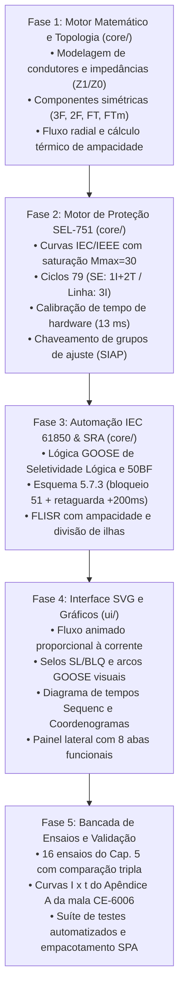

# Plano de Implementação de Recursos no Simulador Web — Equipe Gemini

> **Documento Técnico de Engenharia e Especificação de Desenvolvimento**  
> **Projeto:** Simulador Web de Self-Healing em Redes Inteligentes (SE Aquiraz 69/13,8 kV)  
> **Artigo Vinculado:** *Desenvolvimento de Simuladores Web de Self-Healing Assistido por Inteligência Artificial: Estudo Comparativo entre Gemini e Claude*  
> **Periódico Alvo:** *Journal of Control, Automation and Electrical Systems* (Springer)  
> **Instituição:** Universidade Federal do Ceará (UFC) — Centro de Tecnologia — Departamento de Engenharia Elétrica  
> **Equipe 2 (Gemini):** Paulo Victor Pereira Lima, Lucas Sales  
> **Orientação:** Prof. Raimundo Furtado Sampaio, Prof. Lucas Silveira Melo  

---

## 1. Objetivo do Documento

Este documento estabelece o **plano técnico detalhado e roteiro de implementação** para incorporar no simulador web da **Equipe Gemini** (`diagrama_unifilar_se_aqz.html`) o conjunto completo de recursos físicos, computacionais, didáticos e de automação identificados no simulador de referência desenvolvido pela Equipe Claude ([Web-based-Self-Healing-Simulator](https://github.com/douglas-fdbs/Web-based-Self-Healing-Simulator)).

O objetivo central é atingir **paridade técnica absoluta e diferenciais de qualidade**, garantindo que o simulador assistido pelo Google Gemini disponha de:
1. Máxima exatidão numérica frente ao TCC de base (**Rodrigues, 2015**) e aos dados de campo (**Nobre, 2013**; relatórios da mala **CONPROVE CE-6006**);
2. Motor de eventos discretos com calibração de processamento do relé SEL-751 (13 ms) e tempos de manobra reais;
3. Funções distribuídas da norma **IEC 61850 (mensagens GOOSE)** completas (seletividade lógica, 50BF e retaguarda com somador de tempo);
4. Algoritmo robusto de **Self-Healing (SRA/FLISR)** com restrições de ampacidade térmica, sensibilidade de relés e divisão de ilhas;
5. Interface rica com diagrama unifilar vetorial animado (SVG), coordenogramas log-log, diagrama de tempos no formato Sequenc (mala de testes) e suíte de validação automatizada.

---

## 2. Matriz Comparativa de Recursos (Benchmark)

| Categoria | Funcionalidade Específica | Versão Claude (Equipe 3) | Versão Gemini Atual (Equipe 2) | Meta para o Simulador Gemini |
| :--- | :--- | :---: | :---: | :---: |
| **Topologia** | Rede da Fig. 4.2 do TCC (Base Oficial) | Sim | Parcial (SVG esquemático) | **Completa com dados elétricos de cabos** |
| | Topologia histórica Fig. 4.1 (Nobre, 2013) | Sim | Não | **Implementar seletor de topologias** |
| | Modelagem de condutores por trecho (Z1/Z0/km) | Sim (Tabs. 4.4, 4.5 e 4.6) | Apenas comprimentos | **Modelagem precisa cabo a cabo** |
| **Curto-Circuito** | Componentes simétricas (Eqs. 2.18 a 2.20) | Sim (3F, 2F, FT, FTm) | Simplificado | **3F, 2F, FT franca e FTm ($R_c = 100\ \Omega$)** |
| | Posição contínua da falta no trecho | Slider 0% a 100% | Clique genérico no trecho | **Slider contínuo + clique no SVG** |
| | Faltas temporárias vs. permanentes | Sim (extingue no tempo morto) | Não | **Simulação de faltas temporárias e 79** |
| | Falta em barra de SE e perda de fonte | Sim (AQZ, ESB, AGF) | Não | **Simulação de contingência de subestações** |
| **Proteção** | Modelo SEL-751 (50P/51P, 50N/51N) | Sim (curvas IEC e IEEE) | Estados lógicos básicos | **Curvas IEC/IEEE com disco de indução** |
| | Saturação do múltiplo da curva ($M_{\max} = 30$) | Sim | Não | **Implementar $M_{\max} = 30$ conforme TCC** |
| | Ciclo de religamento 79 diferenciado | Sim (SE: 1I+2T / Linha: 3I) | Não | **Ciclos com tempos mortos e rearme (45s)** |
| | Calibração de processamento do relé (13 ms) | Sim (erro $< 12$ ms na mala) | Não (ideal) | **Parametrização de atraso de hardware (13 ms)** |
| | Chaveamento de grupos de ajuste (SIAP) | Sim (sentido de fluxo/causa) | Não | **Troca automática de grupo conforme fluxo** |
| | Edição interativa de parâmetros dos relés | Sim | Não | **Painel de edição em tempo real** |
| **IEC 61850** | Seletividade Lógica (SL) via GOOSE | Sim (arco visual + torque control) | Não | **Mensagem de bloqueio GOOSE + selo SL** |
| | Falha de Disjuntor (50BF) com trip remoto | Sim (REMTRIP após BFD) | Não | **Simulação de disjuntor travado e 50BF** |
| | Solução 5.7.3 (bloqueio 51 + retaguarda +200ms) | Sim | Não | **Coordenação com somador de retaguarda** |
| | Supervisão de sinal e perda de mensagens | Sim (perda seletiva SL/BF) | Não | **Simulador de falhas na rede de dados** |
| | Mapeamento de Datasets (Tab. 5.1 do TCC) | Sim (PIOC, PTOC, RBRF, PTRC) | Não | **Exibição dos nós lógicos e pacotes** |
| **Self-Healing** | Localização por passagem de falta | Sim | Não | **Algoritmo de localização de zona** |
| | Isolamento de zona e fronteiras travadas | Sim | Não | **Isolamento automático e expansão por falha** |
| | Recomposição com restrição de ampacidade | Sim | Não | **Verificação térmica rigorosa dos condutores** |
| | Restrição por pickup de relé na rota de socorro | Sim | Não | **Bloqueio de sobrecarga de pickup** |
| | Divisão ótima de ilhas desenergizadas | Sim (T13/T14) | Não | **Desmembramento de ilha para evitar sobrecarga** |
| | Intertravamento contra paralelismo/malha | Sim | Não | **Bloqueio elétrico contra malhas radiais** |
| **Interface/Didática** | Sentido e fluxo animado proporcional à corrente | Sim (velocidade $\propto I$) | Estático | **Traçado vetorial com velocidade dinâmica** |
| | Destaque do caminho de curto e raio animado | Sim | Parcial | **Destaque vermelho do circuito sob falta** |
| | Coordenogramas tempo $\times$ corrente (Figs. 4.9-4.13) | Sim (escala log-log) | Não | **Gráfico log-log interativo em SVG** |
| | Diagrama de tempos Sequenc (Figs. 5.12-5.22) | Sim (estilo mala de testes) | Não | **Cronograma de sinais digitais e eventos** |
| | Câmera lenta automática em transitórios | Sim (ms em slow, s acelerado) | Não | **Player temporal adaptativo** |
| | Painel lateral estruturado em 8 abas | Sim | Não | **Barra lateral com abas de análise** |
| | Exportação de eventos em CSV | Sim | Não | **Exportação de oscilografia/eventos em CSV** |
| **Validação** | Reprodução dos 16 ensaios do Cap. 5 | Sim | Não | **Aba dedicada com confronto dos ensaios** |
| | Curvas I $\times$ t do Apêndice A da mala | Sim | Não | **Visualização de curvas experimentais** |
| | Suíte automatizada de testes de regressão | Sim (Node.js `--test`) | Não | **Scripts de validação matemática** |

---

## 3. Arquitetura Modular Proposta para a Solução Gemini

Para manter a conformidade com as diretrizes do projeto e viabilizar tanto a execução em **arquivo único (Single Page Application)** quanto a manutenção em módulos organizados, a arquitetura do simulador Gemini será estruturada da seguinte forma:

```text
self-healing-aquiraz-gemini/
│
├── documentacao/
│   ├── CONTEXTO_E_ESPECIFICACAO_PROJETO.md
│   └── PLANO_IMPLEMENTACAO_RECURSOS_SIMULADOR.md  (este documento)
│
├── .gitignore                          # Exclusão de caches e pastas pesadas locais
│
├── fontes/
│   ├── Tarefa Classroom.pdf
│   └── TCC_MarioSergio_2015_pós defesa (revisão 3).pdf
│   *(dados pesados de ensaios/relatórios locais são excluídos do Git via .gitignore)*
│
├── simulacao/
│   ├── diagrama_unifilar_se_aqz.html       # Simulador Web Principal (SPA Integrada)
│   │
│   ├── src/                                # Módulos estruturados de desenvolvimento
│   │   ├── core/
│   │   │   ├── complex.js                  # Aritmética de números complexos (fásores/impedâncias)
│   │   │   ├── network.js                  # Grafo topológico, conectividade, zonas e fluxo
│   │   │   ├── shortcircuit.js             # Componentes simétricas (3F, 2F, FT, FTm com Rc=100)
│   │   │   ├── protection.js               # Relés SEL-751, curvas IEC/IEEE, ciclo 79 e SIAP
│   │   │   ├── goose_simulator.js          # Barramento de eventos IEC 61850 e mensagens GOOSE
│   │   │   ├── selfhealing_engine.js       # FLISR com ampacidade, pickup e divisão de ilhas
│   │   │   └── coordination_checker.js     # Avaliação de margens (0,3s/0,4s) e sensibilidade
│   │   │
│   │   ├── data/                           # [Diferencial Gemini] Definição desacoplada de dados em JSON
│   │   │   ├── aquiraz_tcc2015.json        # Rede base autocontida da Fig. 4.2 do TCC (Rodrigues, 2015)
│   │   │   ├── aquiraz_nobre2013.json      # Rede histórica autocontida da Fig. 4.1 (Nobre, 2013)
│   │   │   ├── catalogo_cabos.json         # Biblioteca de condutores (impedâncias e ampacidade)
│   │   │   ├── ensaios_lab.json            # 18 ensaios do Cap. 5 e pontos de teste da mala CE-6006
│   │   │   └── schema_rede.json            # JSON Schema formal para validação de novas redes
│   │   │
│   │   └── ui/
│   │       ├── unifilar_renderer.js        # Diagrama SVG com fluxo animado e caminhos de falta
│   │       ├── coordinogram_chart.js       # Gráficos log-log (Figs. 4.9 a 4.13)
│   │       ├── sequenc_timeline.js         # Diagrama de tempos das proteções e GOOSEs
│   │       └── control_panels.js           # Gestão das 8 abas de controle lateral
│   │
│   └── tests/
│       └── validation_tests.js             # Testes automatizados contra as tabelas do TCC
│
└── tools/
    └── build_single_file.py                # Script em Python para empacotar src/ no HTML final
```

---

## 4. Detalhamento Técnico dos Módulos a Implementar

### Módulo 1: Motor Elétrico e de Curto-Circuito (`shortcircuit.js` & `network.js`)
1. **Modelagem de Parâmetros de Linha**:
   - Cada trecho (T1 a T16) deve ser instanciado com o comprimento exato em metros e a composição de condutores de acordo com as Tabelas 4.4 e 4.5 do TCC:
     - Cabo CAA Partridge 266,8 MCM ($R_1 = 0,214\ \Omega/\text{km}$, $X_1 = 0,378\ \Omega/\text{km}$, $R_0 = 0,364\ \Omega/\text{km}$, $X_0 = 1,607\ \Omega/\text{km}$, Ampacidade = 475 A);
     - Cabo CAA Poppy 1/0 AWG ($R_1 = 0,544\ \Omega/\text{km}$, $X_1 = 0,407\ \Omega/\text{km}$, $R_0 = 0,694\ \Omega/\text{km}$, $X_0 = 1,636\ \Omega/\text{km}$, Ampacidade = 242 A);
     - Cabo Cobre Nu 95 mm² ($R_1 = 0,193\ \Omega/\text{km}$, $X_1 = 0,381\ \Omega/\text{km}$, $R_0 = 0,343\ \Omega/\text{km}$, $X_0 = 1,610\ \Omega/\text{km}$, Ampacidade = 438 A);
     - Spacer Cable 240 mm² ($R_1 = 0,125\ \Omega/\text{km}$, $X_1 = 0,110\ \Omega/\text{km}$, $R_0 = 0,275\ \Omega/\text{km}$, $X_0 = 1,339\ \Omega/\text{km}$, Ampacidade = 617 A).
   - Conversão de impedâncias para a base do sistema ($S_{\text{base}} = 100\ \text{MVA}$, $V_{\text{base}} = 13,8\ \text{kV}$, $I_{\text{base}} = 4.183,7\ \text{A}$, $Z_{\text{base}} = 1,9044\ \Omega$).
2. **Cálculo de Curto-Circuito (Componentes Simétricas)**:
   - Determinação da impedância Thévenin acumulada de sequência positiva ($Z_1$) e sequência zero ($Z_0$) da fonte alimentadora até o ponto de falta:
     $$\dot{I}_{cc}^{3\phi} = \frac{V_{\text{pre}}}{|Z_1|}$$
     $$\dot{I}_{cc}^{2\phi} = \frac{\sqrt{3} \cdot V_{\text{pre}}}{|2 Z_1 + R_f|}$$
     $$\dot{I}_{cc}^{FT} = \frac{3 \cdot V_{\text{pre}}}{|2 Z_1 + Z_0 + 3 R_f|}$$
     $$\dot{I}_{cc}^{FTm} = \frac{3 \cdot V_{\text{pre}}}{|2 Z_1 + Z_0 + 3 R_c|} \quad (\text{com } R_c = 100\ \Omega)$$
3. **Fluxo de Carga e Verificação Térmica**:
   - Modelagem de carga por trecho (considerando as correntes nominais da Tabela 4.2 do TCC).
   - Cálculo da corrente total transitada por condutor e teste de ultrapassagem da ampacidade nominal.

---

### Módulo 2: Motor de Proteção e Relegação SEL-751 (`protection.js`)
1. **Curvas de Tempo Inverso (IEC 60255 / IEEE C37.112)**:
   - Implementação da equação geral:
     $$t(I) = TD \cdot \left[ \frac{\beta}{\left(\frac{I}{I_{\text{pickup}}}\right)^\alpha - 1} + L \right]$$
   - Parâmetros IEC:
     - *Normalmente Inversa (NI):* $\beta = 0,14$, $\alpha = 0,02$, $L = 0$;
     - *Muito Inversa (MI):* $\beta = 13,5$, $\alpha = 1,0$, $L = 0$;
     - *Extremamente Inversa (EI):* $\beta = 80$, $\alpha = 2,0$, $L = 0$.
   - **Limitador de Múltiplo:** limitar a corrente da curva a $M_{\max} = 30 \times I_{\text{pickup}}$, evitando tempos assintoticamente nulos em curtos de elevada intensidade e replicando exatamente as curvas do TCC.
2. **Integração do Disco de Indução**:
   - O acumulador de sobrecorrente deve integrar continuamente a fração de curso do disco em regime transitório:
     $$\Delta \theta = \int \frac{dt}{t_{\text{op}}(I(t))}$$
3. **Ciclo de Religamento Automático (ANSI 79)**:
   - *Religadores da Subestação:* ciclo $1I + 2T$ correspondente a 4 disparos sequenciais: 1º Instantâneo (50/50N), 2º Instantâneo (50/50N), 3º Temporizado (51/51N), 4º Temporizado (51/51N) antes do bloqueio definitivo (*lockout*).
   - *Religadores de Linha:* ciclo $3I$ (3 operações instantâneas com tempo de coordenação reduzido a cada escalão).
   - *Temporizadores:* tempo morto de 10 s (SE) com acréscimo de 1 s para cada nível a jusante; tempo de rearme (*reset time*) calibrado em 45 s.
4. **Calibração de Atraso Físico (13 ms)**:
   - Adicionar o atraso intrínseco de processamento de hardware de **13 ms** para os elementos 50/50N e lógica de 50BF, permitindo replicar as oscilografias e relatórios do software Sequenc da Conprove.
5. **SIAP (Sistema Inteligente de Ajuste de Proteção)**:
   - Troca dinâmica para o Grupo 2 quando o religador passa a receber potência da subestação de socorro (SE ESB ou SE AGF), invertendo sentido de coordenação e adaptando pickups de neutro e fase.

---

### Módulo 3: Automação e Comunicação IEC 61850 (`goose_simulator.js`)
1. **Lógica de Seletividade Lógica (SL)**:
   - Quando um relé a jusante detecta *pickup* de corrente (fase ou neutro), publica instantaneamente mensagem GOOSE de bloqueio com latência de transmissão de 3 ms (classe TT6 da IEC 61850-5).
   - O relé a montante inibe seu elemento instantâneo 50P/50N por meio da entrada lógica de bloqueio (*torque control*), permitindo que o religador de linha elimine faltas no alimentador sem desligar o disjuntor geral da barra (ponto crítico da seção 4.7.3).
2. **Proteção contra Falha de Disjuntor (ANSI 50BF)**:
   - Iniciação pelo comando de trip do relé local.
   - Temporizador BFD (*Breaker Failure Delay*) configurável (padrão 200 ms).
   - Se a corrente de carga/curto continuar circulando acima do limiar após 200 ms, é disparada a mensagem GOOSE com atributo `BFR1RBRF1.OpEx.general = TRUE` (*REMTRIP*), ordenando a abertura imediata do disjuntor de retaguarda a montante.
3. **Esquema Avançado com Bloqueio de 51 e Retaguarda com Somador**:
   - Conforme demonstrado no ensaio 5.7.3 do TCC, bloquear também o elemento temporizado 51 e habilitar a curva de retaguarda somada ($51 + 200\text{ ms}$), garantindo tempo hábil para o 50BF operar sem perda de seletividade.
4. **Supervisão de Qualidade do Canal (Fig. 3.8)**:
   - Em caso de perda das mensagens GOOSE de bloqueio (falha de switch ou rede), o relé a montante inibe preventivamente sua unidade instantânea e passa a atuar estritamente por tempo inverso coordenado.

---

### Módulo 4: Sistema de Recomposição Automática — Self-Healing / SRA (`selfhealing_engine.js`)
1. **Etapa 1: Localização (FL)**:
   - Rastreamento dos IEDs que registraram partida (*everPicked*). A zona em falta corresponde ao trecho situado imediatamente após o último dispositivo a jusante que sensibilizou.
2. **Etapa 2: Isolamento (FI)**:
   - Abertura telecomandada de todas as chaves seccionadoras e religadores que delimitam a zona de defeito.
   - Se uma chave de fronteira estiver com falha de abertura mecânica (*breaker failure / stuck*), a área isolada é automaticamente expandida para envolver o próximo equipamento manobrável.
   - Desconexão e isolamento de barramentos de subestação sem suprimento.
3. **Etapa 3: Restauração de Serviço (SR)**:
   - Avaliação sistemática de todas as chaves normalmente abertas de interligação (RL1, RL2, RL3, RL4).
   - **Critérios de Validação da Manobra:**
     1. Ausência de malha ou paralelismo de fontes independentes;
     2. Não violação da ampacidade térmica máxima em nenhum trecho do circuito de socorro ($I_{\text{fluxo}} \le I_{\text{ampacidade}}$);
     3. Corrente de carga pós-manobra inferior ao pickup de sobrecorrente de fase dos relés da rota ($I_{\text{carga}} < I_{\text{pickup}}$).
4. **Divisão de Ilhas Desenergizadas**:
   - Se a transferência de uma ilha inteira causar sobrecarga (exemplo documentado no TCC em que a transferência de T13 + T14 para a SE AGF sobrecarregaria o condutor de T16 acima de 438 A), o algoritmo deve dividir a ilha abrindo chaves intermediárias (RS6), restaurando o maior bloco de carga suportado (T14) e mantendo isolado o excedente (T13).

---

### Módulo 5: Interface Vetorial SVG e Gráficos Científicos (`ui/`)
1. **Diagrama Unifilar Interativo em SVG**:
   - Cores representativas das subestações alimentadoras:
     - **Azul (#1e63c6):** SE Aquiraz (AQZ 69/13,8 kV);
     - **Roxo (#7c3aed):** SE Eusébio (ESB 69/13,8 kV);
     - **Laranja (#ea580c):** SE Água Fria (AGF 69/13,8 kV);
     - **Cinza (#6b7280):** Trechos desenergizados / ilhados.
   - **Fluxo Animado Dinâmico:** traçado tracejado móvel com velocidade calculada em função da corrente ($v \propto \sqrt{I}$), com inversão visual de direção quando o alimentador for socorrido pelo extremo oposto.
   - **Visualização de Grandezas em Tempo Real:** rótulos opcionais com as correntes de carga por trecho (A).
   - **Arcos Vetoriais GOOSE:** emissão de curvas parabólicas coloridas sobre o diagrama interligando os IEDs durante a troca de mensagens de bloqueio e 50BF.
   - **Sinalizadores Operacionais nos Religadores:** selos visuais com `SL` (bloqueado por seletividade lógica) e `BLQ` (religamento bloqueado/lockout), além de contador regressivo de tempo morto em segundos.
2. **Motor de Reprodução Temporal Adaptativa**:
   - Botões de *Play*, *Pause*, *Reset*, *Avanço Rápido* e *Pulo para o Fim*.
   - **Câmera Lenta Automática:** redução automática da velocidade nos transitórios críticos de milissegundos (trips de 50P, envios de GOOSE e atuações de disjuntor) e avanço acelerado durante os intervalos mortos de religamento (10 a 13 s).
3. **Painel Lateral em 8 Abas Especializadas**:
   - **Aba 1 (Falta):** slider de posição ao longo do trecho (0 a 100%), seletor do tipo de curto (3F, 2F, FT, FTm), valor de $R_f$, chave para falta temporária, cenários pré-configurados e simulação de chave travada (*stuck*).
   - **Aba 2 (Eventos):** **Diagrama de tempos em estilo Sequenc** (idêntico à mala CONPROVE, ilustrando correntes, partidas, GOOSEs e abertura de contatos) e log cronológico com exportação em CSV.
   - **Aba 3 (Análises):** balanço de carga suprida vs. interrompida, resumo de tempos de eliminação, gráfico de barras com percentual de carregamento dos cabos e confronto com Tabelas 4.7 e 4.8.
   - **Aba 4 (Proteção):** **Coordenogramas log-log interativos** das Figs. 4.9 a 4.13 do TCC, gráfico das famílias de curvas IEC/IEEE, tabela de ajustes editável e verificação automática dos critérios de coordenação (margem de 0,3s e 0,4s) e sensibilidade.
   - **Aba 5 (IEC 61850):** toggles de ativação de SL, 50BF, 51 de retaguarda, supervisão de qualidade de GOOSE, injeção de latência e perda de pacotes, tabela de datasets e nós lógicos.
   - **Aba 6 (Ensaios):** reprodução direta dos **16 ensaios do Capítulo 5 e Apêndices A e B**, com confronto triplo (*Citado no TCC* $\times$ *Medido no Sequenc* $\times$ *Simulado*).
   - **Aba 7 (Fontes):** notas metodológicas, premissas de projeto e documentação de divergências identificadas nos memoriais da concessionária e do autor.
   - **Aba 8 (Guia):** tutoriais passo a passo com roteiros para aulas e demonstrações acadêmicas.

---

### Módulo 6: Validação Científica e Testes Automatizados (`tests/`)
1. **Confronto Numérico Obrigatório de Curto-Circuito**:
   - *Tabela 4.7 do TCC:* 18 barras $\times$ 4 tipos de curto (3F, 2F, FT, FTm), tolerando erro máximo relativo inferior a $0,1\%$.
   - *Planilha de Cálculos do TCC:* 42 barras englobando fontes AQZ, ESB e AGF, com erro relativo visado inferior a $0,01\%$.
2. **Validação das Recomposições de Self-Healing**:
   - Reprodução exata da recomposição da Fig. 4.3 do TCC (falta em T1: abre RS1 e fecha RL1);
   - Reprodução das 12 recomposições da Tabela 4.2 de Nobre (2013).
3. **Validação Temporal dos Ensaios de Laboratório**:
   - Reprodução dos 16 ensaios do Capítulo 5 do TCC, assegurando que tempos de trip e intervalos entre mensagens GOOSE convirjam com discrepância máxima inferior a 12 ms em relação às medições com a mala CONPROVE CE-6006.

---

## 5. Roteiro de Implementação em Fases (Work Breakdown)



---

## 6. Métricas de Sucesso para o Artigo Comparativo (Springer)

Para que o desenvolvimento assistido pelo Google Gemini evidencie qualidade superior ou equivalência de ponta no estudo comparativo com o Claude, os seguintes critérios quantitativos e qualitativos devem ser alcançados:

1. **Rigor e Fidelidade Numérica**:
   - Erro médio de curto-circuito $< 0,05\%$ nas 18 barras do sistema radial em relação ao TCC;
   - Acerto em $100\%$ dos casos de recomposição automática documentados no TCC e na monografia de Nobre;
   - Precisão de temporização dos disparos GOOSE inferior a $15\text{ ms}$ em relação aos ensaios com injeção secundária de corrente.
2. **Experiência Didática e Usabilidade**:
   - Execução imediata no navegador (sem necessidade de servidores de backend ou dependências pesadas);
   - Visualização cristalina dos conceitos abstratos da norma IEC 61850 (intertravamentos GOOSE, coordenação lógica e descoordenações eliminadas).
3. **Integridade da Engenharia de Software**:
   - Código modular e bem documentado, com tipagem conceitual e cobertura de testes de regressão;
   - Compatibilidade de execução tanto no ambiente de edição (VS Code Live Preview) quanto em navegadores de usuário final.

